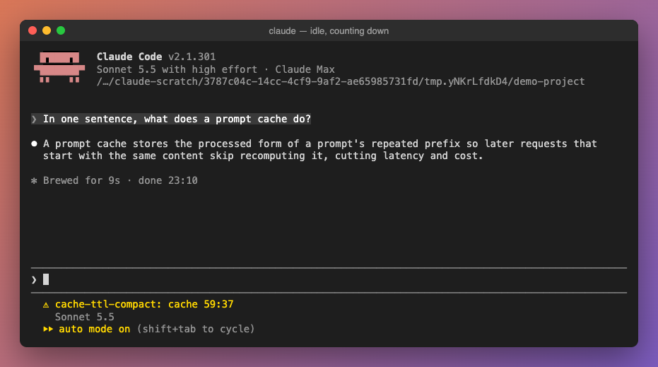
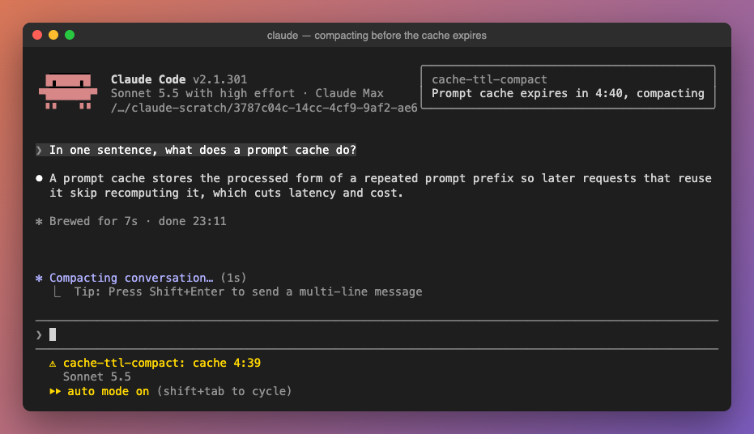

# cache-ttl-compact

[English](README.md) | [日本語](README.ja.md) | **한국어**

프롬프트 캐시가 만료되기까지 남은 시간을 상태 줄에 표시하고, 캐시가 살아 있는 동안 자동으로 `/compact`를 실행하는 Claude Code 플러그인입니다.





## 왜 필요한가

Claude Code는 API 요청마다 대화를 캐시합니다. 캐시는 마지막 요청부터 정해진 시간(TTL) 동안만 유효합니다. 긴 세션을 TTL보다 오래 방치하면 다음 메시지에서 컨텍스트 전체를 캐시에 다시 써야 해서 시간과 토큰이 듭니다.

이 플러그인은 마지막 요청부터 카운트다운하고, 만료 직전에 세션이 유휴 상태라면 캐시가 따뜻할 때 대화를 compact합니다. 돌아왔을 때 식어 버린 거대한 컨텍스트가 아니라 작은 요약에서 다시 시작할 수 있습니다.

## 동작

기본값(TTL `1h`, margin `180`초)일 때:

| 마지막 요청 이후 경과 | 상태 줄 | 동작 |
| --- | --- | --- |
| 1초 | `cache 59:59` | 1초마다 갱신 |
| 57분 | `cache 3:00` | 유휴 상태이고 context가 30k tokens 이상이면 compact하고 토스트로 알림 |
| compact 후 | (사라짐) | 다음 메시지까지 아무것도 하지 않음 |
| 60분 (compact하지 않은 경우) | `cache expired` | 다음 메시지까지 표시 |

- 메인 대화의 요청마다(턴 안의 도구 실행 단계 포함) 카운트다운을 다시 시작합니다. 서브에이전트의 요청은 세지 않습니다.
- 턴이 실행 중일 때는 compact하지 않습니다. 긴 턴이 margin 안에서 끝나면 그 시점에 compact합니다.
- 캐시 주기마다 한 번만 시도합니다. 건너뛰거나 실패하면 로그에 남기고 매초 다시 시도하지 않습니다.
- 어떤 compact(`/compact`, 자동 compact, 다른 플러그인)든 그 뒤에는 다음 요청까지 카운트다운을 지웁니다.
- compact할 때는 진행 중인 작업, 변경한 파일, 설계 결정과 그 이유, 남은 항목을 유지하고, 요약은 대화의 언어로 작성됩니다.

표시는 프롬프트 아래, Claude Code 자체 알림 옆에 `⚠ cache-ttl-compact: cache 59:37`처럼 나타납니다. 기존 `statusLine` 명령을 대체하지 않습니다.

## 설치

Claude Code 터미널 세션의 프롬프트에서:

```
/plugin install cache-ttl-compact --marketplace buddypia/cache-ttl-compact
```

마켓플레이스 추가에 `y`로 답하고 스코프를 고릅니다(user 스코프면 모든 세션에서 로드됩니다).

셸에서:

```sh
claude plugin install cache-ttl-compact --marketplace buddypia/cache-ttl-compact
```

`/plugin`을 쓸 수 없는 데스크톱 앱에서는 프롬프트 입력란 옆 **+** → **Plugins** → **Add marketplace**에서 `buddypia/cache-ttl-compact`를 추가한 뒤 **Add plugin**을 선택합니다.

로컬에 clone해서 쓰려면 `claude --plugin-dir <clone 경로>`로 실행하거나, `~/.claude/settings.json`의 `env` 블록에 있는 `CLAUDE_CODE_PLUGIN_DIRS`에 경로를 추가합니다.

## 설정

`/config` 또는 `~/.claude/settings.json`의 `pluginConfigs`에서 바꿀 수 있습니다:

```json
{
  "pluginConfigs": {
    "cache-ttl-compact": {
      "options": { "ttl": "1h", "marginSeconds": 180, "minContextTokens": 30000 }
    }
  }
}
```

| 항목 | 기본값 | 의미 |
| --- | --- | --- |
| `ttl` | `1h` | 프롬프트 캐시 TTL: `1h` 또는 `5m` |
| `marginSeconds` | `180` | 만료 몇 초 전에 compact할지 |
| `minContextTokens` | `30000` | 이보다 작은 context는 compact하지 않음(작은 context는 다시 캐시해도 저렴하므로) |

스크린샷은 `ttl: 5m`, `marginSeconds: 280`으로 찍은 것이라 요청 20초 뒤에 compact가 실행됩니다.

## 제한 사항

- 플러그인은 캐시 TTL을 읽을 수 없어서 `ttl` 설정값으로 셉니다. TTL이 5분으로 내려가면(사용량이 초과됐을 때 등) `ttl`을 `5m`으로 바꾸세요. `5m`에서는 `marginSeconds`를 `60` 안팎으로 두는 것을 권장합니다.
- 카운트다운은 각 요청을 보낸 시각을 기준으로 한 추정이며, 서버 쪽 캐시 자체는 볼 수 없습니다.

## 개발

```sh
claude plugin validate .
claude plugin test .
```

hooks 모듈은 [`hooks/register.ts`](hooks/register.ts), 테스트는 [`hooks/register.test.ts`](hooks/register.test.ts)에 있습니다.

## 라이선스

[MIT](LICENSE)
